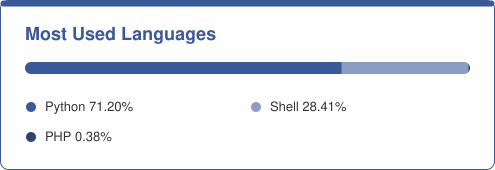

  

  
  
  

---

## Profile &nbsp;`> whoami`

| | |
|---|---|
| **Name** | Avraham (Avi) Lewis Abel |
| **Role** | Computer Systems Technician |
| **Network** | Seneca Polytechnic, Toronto |
| **Education** | Computer Systems Technician (CSN), Ontario College Diploma |
| **Location** | Toronto, Ontario, Canada |
| **Interests** | Linux, cloud infrastructure, networking, automation |
| **Status** | Open to systems administration, network administration and IT support roles |

I graduated from the **Computer Systems Technician (CSN)** program at **Seneca Polytechnic**, with hands-on training in networking, operating systems, security, and cloud computing. I administer **Linux/UNIX** and **Microsoft** environments, deploy and load-balance services in **Microsoft Azure** and **Amazon Web Services (AWS)**, and automate routine administration with **Bash** and **Python**. I value reliable systems, clear documentation and methodical problem-solving.

---

## Education &nbsp;`> cat education.txt`

**Computer Systems Technician (CSN)**, Ontario College Diploma
Seneca Polytechnic, School of Information Technology Administration & Security

- Linux/UNIX and Microsoft system administration
- Local and wide area networks, wireless and software-defined networks
- Cloud services and on-premises deployment
- Maintenance, security, and system design and installation

---

## Skills &nbsp;`> ls ~/skills`

  

| Area | Skills & Technologies |
|---|---|
| **Operating Systems** | Linux (Ubuntu, Linux Mint, Debian 13, Kali), Windows Server, Windows 10/11, Active Directory |
| **Scripting & Automation** | Bash, Python, cron scheduling, log parsing |
| **Virtualization** | VMware Workstation Pro, vSphere, VirtualBox, KVM, libvirt, virsh, VM backup and restore |
| **Cloud** | Microsoft Azure, Amazon Web Services (AWS), load balancing, domain services |
| **Networking** | LAN/WAN fundamentals (Cisco and Aruba), wireless and software-defined networks |
| **Web & Databases** | LAMP stack, WordPress self-hosting, MySQL |
| **Tools** | Git, GitHub, Visual Studio Code, SQL Server Management Studio 22, Microsoft Office |

---

## Projects &nbsp;`> cd ~/projects`

| Project | What it does |
|---|---|
| [**Linux System Administrator Bash Scripts**](https://github.com/aabel3/Linux-System-Administrator-Bash-Scripts) | KVM/libvirt admin toolkit: VM backup and restore, disk monitoring, ping tests and system health checks |
| [**Python Load Balancer Monitor**](https://github.com/aabel3/Python-Load-balancer-monitor) | Monitors the health of a load-balanced setup |
| [**Python Log File Parsing**](https://github.com/aabel3/Python-Parsing-a-log-file-in-2) | Parses and analyzes log files |
| [**Ubuntu LAMP Stack**](https://github.com/aabel3/Ubuntu-LAMP-Stack) | LAMP stack and self-hosted WordPress site on Ubuntu |
| [**Ubuntu & Mint Deployment + Bash Basics**](https://github.com/aabel3/Ubuntu-Mint-Deployment-And-Bash-Scripting-Basics) | Linux VM deployment and Bash scripting fundamentals |
| [**Active Directory Domain Services in Azure**](https://github.com/aabel3/Active-Directory-Domain-Services-in-Mircosoft-Azure) | Domain service set up in Microsoft Azure |
| [**Load Balancing Websites in Azure**](https://github.com/aabel3/Load-Balancing-Websites-in-Microsoft-Azure) | Website deployment and load balancing in Microsoft Azure |

---

## Roles I'm Looking For &nbsp;`> cat career_goals.txt`

- Systems administrator or junior systems administrator
- Network administrator or computer network technician
- Technical support specialist or helpdesk support
- Linux or cloud support

---

## Most Used Languages &nbsp;`> cat languages.txt`

<!-- This chart is the file languages.svg in this repository. To update it, edit the percentages and bar widths in that file. -->

  

---

## Connect &nbsp;`> ./contact.sh`

Interested in working together or have an opportunity in mind? Let's connect on [LinkedIn](https://www.linkedin.com/in/avraham-abel/) or follow my work on [GitHub](https://github.com/aabel3).

